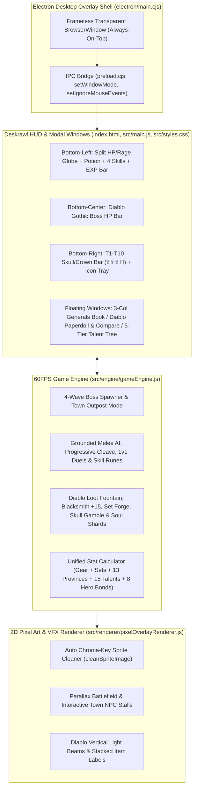

# System Architecture Overview

## 1. High-Level Architecture

## 2. Core Modules

| File | Responsibility |
| :--- | :--- |
| `electron/main.cjs` | Creates the transparent taskbar-docked window, handles `battle` (`215px`) vs `expanded` (`640px`) resizing, and manages click-through hit testing. |
| `src/data/threeKingdomsData.js` | Master database of 60 Generals, 10 Campaign Stages, 6 Equipment Sets, 6 Skill Runes, 13 Provinces, 15 Combat Talents, and 8 Hero Bonds. |
| `src/engine/gameEngine.js` | Complete game state, combat physics, wave spawning, Boss timers, loot generation, Blacksmith crafting, and `localStorage` persistence. |
| `src/renderer/pixelOverlayRenderer.js` | HTML5 Canvas 2D renderer for 4-frame character animations, VFX sprite sheets, Town Outpost stalls, and Diablo loot beams. |
| `src/main.js` | Binds DOM events, updates the 60fps Deskrawl HUD, and renders the 5 modal tabs. |
| `src/styles.css` | Authentic Deskrawl / Diablo dark-bronze and parchment styling. |
